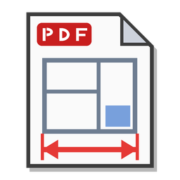

# PDF Layout Measure



Programma per Windows, scritto in Rust, per leggere le misure da un layout in PDF: si calibra la scala
su una distanza nota e si misurano Delta X, Delta Y e distanza in mm.

> **Codice scritto interamente con l'intelligenza artificiale.** Tutto il codice di questo progetto
> (programma, test, script e documentazione) è stato scritto da Claude (Anthropic) con Claude Code.
> L'autore del progetto non ha scritto codice: ha definito le richieste, provato il programma e deciso
> cosa correggere.

## Download

Dalla pagina [Releases](https://github.com/matteo80/pdf-layout-measure/releases):

- `PDFLayoutMeasure-<versione>-setup.exe`: installer (menu Start, disinstallazione da «App installate»,
  nessun permesso da amministratore);
- `PDFLayoutMeasure-<versione>.zip`: si estrae dove si vuole e si avvia `pdf_layout_measure.exe`
  (`pdfium.dll` deve restare accanto all'eseguibile).

## Uso

- **Apri PDF**, oppure trascina il file sulla finestra, oppure `pdf_layout_measure.exe file.pdf`.
- **Calibra scala**: clicca due punti a distanza nota e scrivi la distanza reale in mm
  (`5000`, `5000,5`, `5.000,5` e `5000.5` vanno tutti bene).
- **Misura**: clicca due punti; dopo il primo il risultato segue il mouse.
- Rotella: scorre; Shift + rotella: in orizzontale; Ctrl + rotella: zoom attorno al puntatore;
  trascinando con un tasto qualsiasi: sposta la vista; Esc: annulla la selezione.
- La scala vale per la pagina su cui è stata calibrata.

## Perché in Rust

È il porting dello script Python [`originale/PDFLayoutMeasure_V0.2.2.py`](originale/PDFLayoutMeasure_V0.2.2.py)
(Tkinter + PyMuPDF), che era lento nel disegnare i layout pesanti. Tempi per una tile 512×512 su un A0
con 40.000 linee e 3.000 rettangoli (`cargo run --release --example bench`):

| Zoom | Python V0.2.2 | Rust |
| --- | --- | --- |
| 150% | 164 ms | 17 ms |
| 400% | 159 ms | 9 ms |
| 800% | 160 ms | 6 ms |

- La pagina resta caricata nel thread di rendering: lo script la ricaricava (e MuPDF la rianalizzava)
  per ogni tile.
- I pixel vanno direttamente in una texture GPU, senza passare da PIL e Tk.
- Le richieste superate da uno zoom o da uno spostamento si scartano prima di essere disegnate.
- Sotto le tile ci sono un'anteprima della pagina intera e, durante lo zoom, le tile della scala
  precedente: la vista non resta mai vuota.
- Rendering alla risoluzione reale dello schermo (anche HiDPI), tile allineate ai pixel.

Interfaccia con [egui/eframe](https://github.com/emilk/egui) e wgpu; PDF disegnato da
[pdfium](https://pdfium.googlesource.com/pdfium/) (il motore PDF di Chrome) tramite
[pdfium-render](https://github.com/ajrcarey/pdfium-render).

## Compilazione

Serve [Rust](https://rustup.rs) (toolchain MSVC).

```
powershell -ExecutionPolicy Bypass -File scarica_pdfium.ps1
cargo build --release
cargo test
```

`scarica_pdfium.ps1` mette in `third_party\pdfium` i binari di
[pdfium-binaries](https://github.com/bblanchon/pdfium-binaries) (versione provata: chromium/8152).
Il programma cerca `pdfium.dll` accanto all'exe, nelle sottocartelle `pdfium\` e `tools\` e, nelle
build di sviluppo, in `third_party\pdfium\bin`.

Pacchetto da distribuire (zip e, se c'è Inno Setup 6, installer in `dist\`):

```
powershell -ExecutionPolicy Bypass -File pacchetto.ps1
```

## Struttura

| File | Contenuto |
| --- | --- |
| `src/viewer.rs` | widget `PdfMeasure`: barra, vista a tile, overlay, risultati |
| `src/render.rs` | thread di rendering con pdfium, coda dei lavori con priorità |
| `src/tiles.rs` | griglia delle tile e ordine di priorità |
| `src/measure.rs` | calibrazione, misure, numeri all'italiana |
| `src/main.rs` | finestra del programma |

Il widget funziona dentro qualsiasi `egui::Ui`: lo stesso codice è usato dalla finestra «Misure PDF» di
[Dima 3D](https://github.com/matteo80/dima3d).

## Licenza

Distribuito con licenza MIT: vedi [`LICENSE`](LICENSE). Le licenze e le note di copyright delle librerie
incluse sono nella cartella [`licenses`](licenses): `librerie-rust.txt` per le librerie Rust
(rigenerabile con `python licenses/genera_licenze_rust.py`) e `pdfium-licenze.txt` per pdfium (BSD) e
le librerie che include.
